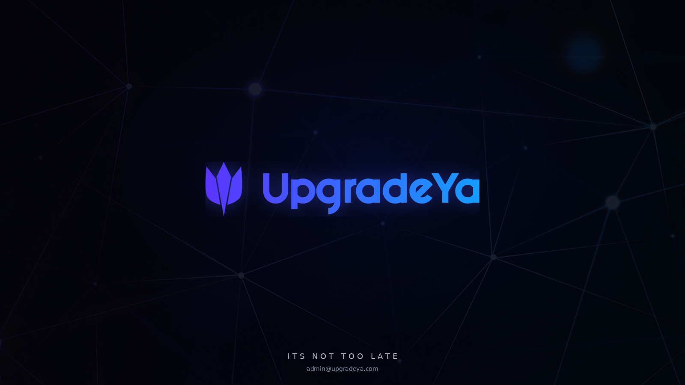

# UpgradeYa Splash — Design Brief

## Objective

Replace the dated card-based landing page with a single, cinematic identity moment: an alive background, an unmistakable centered UpgradeYa mark, and one quiet contact path.

The page should tell people who already know UpgradeYa that something is moving behind the curtain. It should not explain the business, sell services, or feel like a template.

## Recommended direction: Signal Field



*This frame establishes hierarchy, color, and atmosphere. The network and logo lighting become fluid in the approved implementation.*

The current page already contains the right seed: dark space, electric blue/purple light, and connected points. The problem is not the idea; it is the static stock-image treatment and the large white Bootstrap card sitting on top of it.

The new direction turns that network into a restrained living field:

- Near-black navy depth rather than flat black
- A sparse constellation of nodes and fine connective lines
- Slow, organic drift rather than screensaver chaos
- Occasional light traveling through a connection like a signal
- Purple-to-electric-blue color movement coordinated across the field and logo
- A centered logo that feels embedded in the environment, not pasted over it

The motion should feel expensive because it is controlled. Nothing spins, bounces, explodes, or follows the cursor like a toy.

## Content hierarchy

1. **UpgradeYa logo** — only primary content, centered to the actual viewport
2. **ITS NOT TOO LATE** — anchored near the bottom
3. **admin@upgradeya.com** — directly below the tagline, clickable via `mailto:`

Remove:

- The white tile/card
- `Bitcoin Mining`
- `Charleston, SC`
- `steve@upgradeya.com`
- `marc@upgradeya.com`
- Bootstrap layout remnants
- Any navigation, explanation, social links, or call-to-action button

## Composition

```text
┌──────────────────────────────────────────────────────────┐
│                                                          │
│          sparse animated signal field / darkness         │
│                                                          │
│                                                          │
│                     [ UpgradeYa logo ]                    │
│                  exact viewport center                    │
│                                                          │
│                                                          │
│                                                          │
│                     ITS NOT TOO LATE                      │
│                    admin@upgradeya.com                    │
│                                                          │
└──────────────────────────────────────────────────────────┘
```

The logo does not shift position to make room for the footer. It remains centered in the viewport. Footer spacing uses mobile safe-area insets so it never collides with browser chrome.

## Logo treatment

The current transparent logo asset is recognizable and useful. Keep its icon, custom wordmark, proportions, and spacing unchanged.

Proposed treatment:

- Use the logo silhouette as a mask
- Fill it with the same living violet/blue gradient used by the field
- Add a very soft bloom that rises and falls with nearby signal activity
- Allow restrained color travel across the mark
- Keep edges crisp and the wordmark fully legible
- Never distort, rotate, scatter, or physically move the logo away from center

The logo should blend with the world through color and light—not through reduced legibility.

## Palette

- **Void:** `#03040C`
- **Deep navy:** `#081126`
- **Signal violet:** `#5B35FF`
- **Electric blue:** `#168CFF`
- **Cold highlight:** `#D9E7FF`
- **Footer text:** `rgba(235, 242, 255, 0.72)`

The palette may drift within blue, violet, and rare hints of cyan. Avoid rainbow cycling, hot pink dominance, matrix green, and crypto-cliché orange.

## Typography

The logo is the brand typography. Supporting copy should be deliberately neutral:

- Native system sans-serif stack
- Uppercase tagline with wide tracking
- Lowercase email with modest tracking
- No external font request
- No decorative type that competes with the wordmark

## Responsive behavior

- Desktop logo target: approximately `560–680px` wide, capped by the asset's quality
- Mobile logo target: `72–82vw`
- Footer target: `24–36px` above the safe-area edge
- Preserve generous negative space on every viewport
- Portrait layouts use fewer, larger field forms instead of shrinking desktop complexity

## Emotional target

- Mysterious, not vague
- Technical, not nerdy
- Premium, not glossy
- Alive, not busy
- Confident, not promotional

## Alternate directions considered

### Aurora Veil

Slow liquid light and fog with no network geometry. It would be elegant and fast, but it loses too much of the current visual DNA.

### Particle Horizon

A field of depth-layered particles converging around the centered logo. It would feel cinematic, but it risks looking like a generic tech launch.

### Decision

**Signal Field is the recommended direction.** It upgrades what already belongs to UpgradeYa instead of replacing it with fashionable wallpaper.
